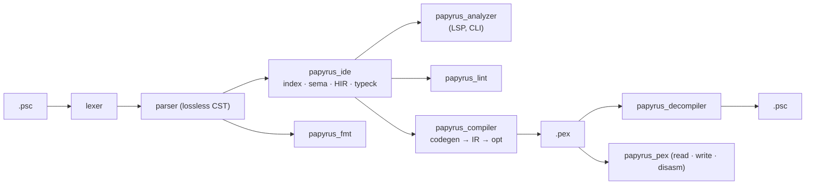

# Developer guide

How papyrus_analyzer is built and how to work on it. For using it, see [readme.md](../readme.md).

## Architecture

| Crate | Role |
| --- | --- |
| `papyrus_intern` | case-insensitive string interner |
| `papyrus_lexer` / `papyrus_parser` | zero-copy lexer, resilient LL parser |
| `papyrus_ide` | workspace, name resolution, types, IDE features, assists |
| `papyrus_lint` | lints and their fixes |
| `papyrus_fmt` | formatter |
| `papyrus_compiler` | compiler and its CLI |
| `papyrus_pex` | `.pex` model, reader, writer, disassembler, `pexdiff` |
| `papyrus_decompiler` | decompiler |
| `papyrus_project` | `papyrus.toml` |
| `papyrus_analyzer` | language server and the `papyrus_analyzer` CLI |

The VS Code extension lives in `extension/`; `schemas/papyrus.schema.json` is the schema of `papyrus.toml`.

## Contributing

One file per feature, plus one line in a list:

| Add | Where |
| --- | --- |
| lint (+ fix) | `crates/papyrus_lint/src/lints/` → `LINTS` |
| assist | `crates/papyrus_ide/src/assists/` → `HANDLERS` |
| snippet | `crates/papyrus_ide/src/features/snippets/*.psc` → `SNIPPETS` |
| keyword docs | `crates/papyrus_ide/src/features/keyword_docs/*.md` |

Tests (`cargo test`):

- every script of `tests/corpus` parses without diagnostics;
- the compiler matches the official one (`pexdiff --loose`), the decompiler round-trips.

`tests/`:

| Path | What | Who changes it |
| --- | --- | --- |
| `tests/corpus` | scripts compiled by the official compiler (git submodule) | read-only |
| `tests/fmt` | `input.psc` → `expected.psc`, the formatter fixture | the tests |
| `tests/playground` | a project (`papyrus.toml`, `src/`) to try the extension and the CLI on; `src/Base.psc` and `src/Child.psc` (compiler features, `Parent`), `src/Lints.psc` (each lint and the attributes, silenced by its first line), `tests/ChildTests.psc` (tests, mocks, events, watch expressions of the debugger) | anyone, any time — no test reads it |
| `tests/playground/src/Scratch.psc` | an empty script to play with | free to edit |

## Building the extension

- `npm run debug` — debug server and extension, run before the `Run Papyrus Analyzer Extension` launch configuration (F5).
- `npm run release` — release server and extension in `build/`.
- `npm run package` — `build/papyrus-analyzer.vsix` for this machine.
- `npm run check` — type checks the extension.
- `npm run grammar` — regenerates the TextMate grammars of `syntaxes/`.

`build.cjs` does the packaging; everything goes to `build/`:

- `node build.cjs` — copies the server next to the extension.
- `node build.cjs --vsix --target <triple>` — builds `build/papyrus-analyzer-<platform>.vsix`.

## CI

- `ci.yaml` — `cargo fmt`, then clippy and the tests on Windows, Linux and macOS.
- `build.yaml` — the VSIX and an archive of `papyrus_analyzer` (zip on Windows, else tar.gz) of each platform: artifacts on `main` and pull requests, attached to the GitHub release on tags (`release-lto` profile).

## Todo

- [x] Lexer, parser, formatter
- [x] Name resolution, type checker
- [x] Language server
- [x] Linter
- [x] Compiler, decompiler
- [ ] Inlining optimization
- [ ] Papyrus virtual machine (unit tests)
