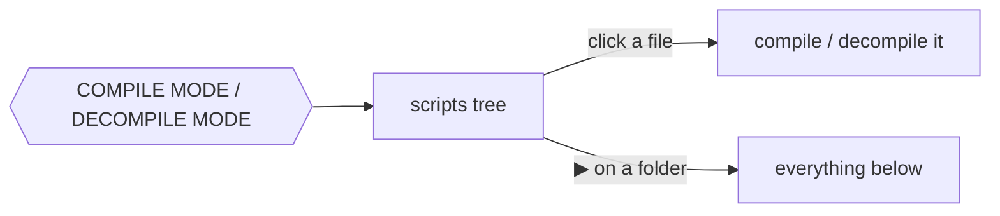
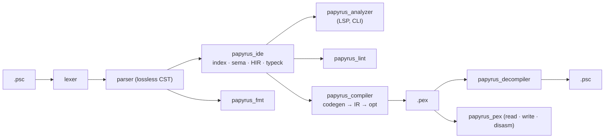

# Papyrus

Tooling for the Papyrus scripting language of Skyrim, in Rust.


## Features

- **Language server** (VS Code extension included)
  - diagnostics like the official compiler, with related places (`defined here`)
  - hover, go to definition / declaration (overridden function), references, rename
  - completion, signature help, snippets, inlay hints (parameters, `overrides Quest`)
  - code actions: quick fixes, De Morgan, inline variable
  - semantic tokens, folding, symbols, formatting
- **Compiler**: `.psc` → `.pex`, same code as `PapyrusCompiler.exe`, same arguments
- **Decompiler**: `.pex` → `.psc` that compiles back to the same code
- **Linter**: clippy-like levels and groups, `--fix`
- **Formatter**, **disassembler**

## Quick start

```sh
papyrus_analyzer                       # language server (stdio)
papyrus_compiler MyQuest -i=Source -o=Scripts -f=TESV_Papyrus_Flags.flg
papyrus_analyzer compile               # the project of papyrus.toml
papyrus_analyzer decompile -o out Scripts/    # whole folders, structure kept
papyrus_analyzer lint [--fix] [-D warnings] [PATH]...
papyrus_analyzer fmt [--check] [PATH]...
papyrus_analyzer disasm Foo.pex
```

VS Code: the **Papyrus** view of the activity bar compiles or decompiles in one click.



## Architecture



| Crate | Role |
| --- | --- |
| `papyrus_intern` | case-insensitive string interner |
| `papyrus_lexer` / `papyrus_parser` | zero-copy lexer, resilient LL parser |
| `papyrus_ide` | workspace, name resolution, types, IDE features, assists |
| `papyrus_lint` | lints and their fixes |
| `papyrus_fmt` | formatter |
| `papyrus_compiler` | compiler and its CLI |
| `papyrus_pex` | `.pex` model, reader, writer, disassembler, `pexdiff` |
| `papyrus_decompiler` | decompiler |
| `papyrus_project` | `papyrus.toml` |
| `papyrus_analyzer` | language server and the `papyrus_analyzer` CLI |

## `papyrus.toml`

Optional: without it, the workspace and the installed game scripts are used ("limited" mode).

```toml
[compiler]                      # no path: the built-in compiler
path = "${SKYRIM_DIR}/Papyrus Compiler/PapyrusCompiler.exe"

[build]
sources = ["."]
output = "output"               # decompiled scripts go to output/decompile
imports = ["${SKYRIM_DIR}/Data/Scripts/Source"]
flags = "${SKYRIM_DIR}/Data/Scripts/Source/TESV_Papyrus_Flags.flg"

[lints]
complexity = "allow"
unused-local = "deny"

[format]
indent-style = "space"
indent-size = 4
```

- Machine paths are `${NAME}` variables, taken from (first wins):
  1. the `papyrus.var` setting / `--var NAME=VALUE`
  2. `[var]` of `papyrus.local.toml` (not committed)
  3. `[var]` of `papyrus.toml`
- Built-ins: `${env:NAME}`, `${workspaceFolder}`, `${game:SkyrimSE}` (registry, Windows).
- Without manifest, outputs go to `build/papyrus/{compile,decompile}`.
- `Papyrus: Create papyrus.toml` writes a commented template.

### Workspaces

Several mods in one folder, like Cargo workspaces:

```text
my-mods/
├─ papyrus.toml          # [workspace]: members + shared settings
├─ MCMHelper/
│  ├─ papyrus.toml       # [package] name = "MCMHelper"
│  └─ Source/Scripts/MCM.psc
└─ Requiem/
   ├─ papyrus.toml       # [dependencies] MCMHelper = { path = "../MCMHelper" }
   └─ Source/Scripts/REQ_MCM_DataStorage.psc
```

```toml
# my-mods/papyrus.toml
[workspace]
members = ["*"]                 # subdirectories with a papyrus.toml; or explicit paths
exclude = ["Old"]

[workspace.var]
SKYRIM_DIR = "C:/Games/Skyrim Special Edition"

[workspace.build]               # defaults of every member
imports = ["${SKYRIM_DIR}/Data/Scripts/Source"]
flags = "${SKYRIM_DIR}/Data/Scripts/Source/TESV_Papyrus_Flags.flg"

[workspace.lints]
style = "allow"
```

- Inherited: `[workspace.var]`, `compiler`, `build`, `lints`, `format`; the member's own values win (imports are appended).
- A member sees only its sources, its `[dependencies]` (transitively) and its imports, like the compiler:
  - `MCM` in Requiem → `MCMHelper/…/MCM.psc`.
  - A sibling member that is not a dependency is invisible: no false `name-is-type`.
- Opening a member folder loads the whole workspace.
- Each member compiles into its own `output`; lints and format follow the member.

## Lints

- Levels: `allow` · `warn` · `deny` (error).
- Groups: `correctness` (deny) · `suspicious` · `complexity` · `style` (warn) · `pedantic` (allow).
- Precedence: lint name > group > `all`; command line flags win over `papyrus.toml`.

```sh
papyrus_analyzer lint --list
papyrus_analyzer lint -D warnings -A style --fix Scripts/Source
```

## Contributing

One file per feature, plus one line in a list:

| Add | Where |
| --- | --- |
| lint (+ fix) | `crates/papyrus_lint/src/lints/` → `LINTS` |
| assist | `crates/papyrus_ide/src/assists/` → `HANDLERS` |
| snippet | `crates/papyrus_ide/src/features/snippets/*.psc` → `SNIPPETS` |
| keyword docs | `crates/papyrus_ide/src/features/keyword_docs/*.md` |

Tests (`cargo test`):

- every script of `tests/fixtures/papyrus-compiler-test-sources` parses without diagnostics;
- the compiler matches the official one (`pexdiff --loose`), the decompiler round-trips.

## Packaging

- `node dist.cjs` — copies the server next to the extension.
- `node dist.cjs --vsix --target <triple>` — builds `papyrus-analyzer-<platform>.vsix` (used by CI).

## Todo

- [x] Lexer, parser, formatter
- [x] Name resolution, type checker
- [x] Language server
- [x] Linter
- [x] Compiler, decompiler
- [ ] Inlining optimization
- [ ] Papyrus virtual machine (unit tests)

## Thanks

- [rust-analyzer](https://github.com/rust-lang/rust-analyzer) — design studied closely
- [russo-2025/papyrus-compiler](https://github.com/russo-2025/papyrus-compiler)
- [matklad's resilient LL parsing](https://matklad.github.io/2023/05/21/resilient-ll-parsing-tutorial.html)

## License

This code was created by studying rust-analyzer; as a whole it can be considered a product of it.

```txt
SPDX-FileCopyrightText: (C) 2026 rust-analyzer team
SPDX-License-Identifier: Apache-2.0 OR MIT
```
