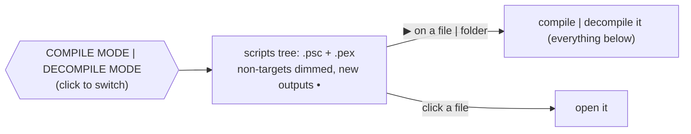

# Papyrus

Tooling for the Papyrus scripting language of Skyrim, in Rust.


## Features

| Tool                             | What                                                                    |
| -------------------------------- | ----------------------------------------------------------------------- |
| **Language server**              | VS Code extension included, see below                                   |
| **Compiler**                     | `.psc` → `.pex` — same code and same arguments as `PapyrusCompiler.exe` |
| **Decompiler**                   | `.pex` → `.psc` — compiles back to the same code                        |
| **Linter**                       | clippy-like levels and groups, `--fix`                                  |
| **Formatter** · **Disassembler** | `fmt` · `disasm`                                                        |

Language server:

|              |                                                                                      |
| ------------ | ------------------------------------------------------------------------------------ |
| Diagnostics  | like the official compiler, with related places (`defined here`)                     |
| Navigation   | hover · definition · declaration (overridden function) · references · rename         |
| Editing      | completion · signature help · snippets · inlay hints (parameters, `overrides Quest`) |
| Code actions | quick fixes · De Morgan · inline variable                                            |
| Display      | semantic tokens · folding · symbols · formatting                                     |

## Quick start

```sh
papyrus_analyzer                                  # language server (stdio)
papyrus_analyzer compile                          # the project of papyrus.toml
papyrus_analyzer decompile -o out Scripts/        # whole folders, structure kept
papyrus_analyzer lint [--fix] [-D warnings] [PATH]...
papyrus_analyzer fmt [--check] [PATH]...
papyrus_analyzer disasm Foo.pex
papyrus_compiler MyQuest -i=Source -o=Scripts -f=TESV_Papyrus_Flags.flg   # PapyrusCompiler.exe compatible
```

VS Code: the **Papyrus** view of the activity bar shows `.psc` and `.pex` together and compiles | decompiles in one click.



Header rows: `Compiler:` built-in | `[compiler] path` · `Output:` the output directory of the mode (click → reveal).

## `papyrus.toml`

Optional. The two modes:

|             | with `papyrus.toml`               | without ("limited")                                  |
| ----------- | --------------------------------- | ---------------------------------------------------- |
| Sources     | `[build] sources`                 | the workspace folders                                |
| Imports     | `[build] imports`                 | the installed game scripts (`SKYRIM_DIR` → registry) |
| Compiler    | `[compiler] path` \| built-in     | built-in                                             |
| Output      | `[build] output` (+ `/decompile`) | `build/papyrus/{compile,decompile}`                  |
| Diagnostics | every source script               | open scripts only                                    |

```toml
[package]
name = "MyMod"
version = "0.1.0"

[var]                           # NAME = "value", used as ${NAME}
SKYRIM_DIR = "${game:SkyrimSE}"

[compiler]
path = "${SKYRIM_DIR}/Papyrus Compiler/PapyrusCompiler.exe"   # unset → built-in compiler
args = []                       # extra arguments, passed as is

[build]                         # relative paths → relative to this file
sources = ["."]                 # script directories, searched recursively
output = "output"               # .pex files (decompiled: output/decompile)
imports = ["${SKYRIM_DIR}/Data/Scripts/Source"]   # lookup order, after sources
flags = "${SKYRIM_DIR}/Data/Scripts/Source/TESV_Papyrus_Flags.flg"   # required by PapyrusCompiler.exe; unset → built-in Skyrim flags
optimize = true                 # true | false
release = false                 # true | false — strip DebugOnly calls
final = false                   # true | false — strip BetaOnly calls
quiet = true                    # true | false — errors only

[dependencies]                  # other projects whose sources this one sees
MCMHelper = { path = "../MCMHelper" }

[lints]                         # lint name | group | "all" = level
all = "warn"                    # "allow" | "warn" | "deny"
complexity = "allow"            # group: correctness | suspicious | complexity | style | pedantic
unused-local = { level = "deny" }   # "level" | { level = "level" }

[format]                        # unset → .editorconfig → editor settings
indent-style = "space"          # "space" | "tab"
indent-size = 4                 # 1..=16
keyword-case = "canonical"      # "canonical" | "preserve" | "PascalCase" | "camelCase" | "lowercase" | "UPPERCASE"
# Names: same values; "canonical" = as defined, the other cases start from the definition
script-case = "canonical"       # actor → Actor (its ScriptName)
function-case = "canonical"     # getvalue() → GetValue(), event oninit() → the overridden OnInit
property-case = "canonical"
variable-case = "canonical"     # locals, parameters, script variables
flag-case = "canonical"         # hidden → Hidden (the flags file)
max-blank-lines = 1
newline = "auto"                # "auto" | "lf" | "crlf"
final-newline = true            # true | false

[format.keywords]               # spelling of single keywords; case only, wins over keyword-case
as = "As"
```

`Papyrus: Create papyrus.toml` writes a commented template.

### Variables

Machine paths are `${NAME}` variables. Lookup order, first wins:

`papyrus.var` setting | `--var NAME=VALUE` > `[var]` of `papyrus.local.toml` (not committed) > `[var]` of `papyrus.toml`

| Built-in             | Value                                                                                                    |
| -------------------- | -------------------------------------------------------------------------------------------------------- |
| `${env:NAME}`        | environment variable                                                                                     |
| `${workspaceFolder}` | the workspace folder                                                                                     |
| `${game:SkyrimSE}`   | game installation from the registry (Windows) — `SkyrimLE` \| `SkyrimVR` \| `Enderal` \| `EnderalSE` too |
| `~`                  | home directory (leading only)                                                                            |

### Workspaces

Several mods in one folder, like Cargo workspaces:

```text
my-mods/
├─ papyrus.toml          # [workspace]: members + shared settings
├─ MCMHelper/
│  ├─ papyrus.toml       # [package] name = "MCMHelper"
│  └─ Source/Scripts/MCM.psc
└─ Requiem/
   ├─ papyrus.toml       # [dependencies] MCMHelper = { path = "../MCMHelper" }
   └─ Source/Scripts/REQ_MCM_DataStorage.psc
```

```toml
# my-mods/papyrus.toml
[workspace]
members = ["*"]                 # "dir" | "dir/*" (subdirectories with a papyrus.toml); ${NAME} allowed
exclude = ["Old"]               # same as members

[workspace.var]                 # variables of every member
SKYRIM_DIR = "C:/Games/Skyrim Special Edition"

[workspace.compiler]            # path | args — defaults of every member
[workspace.build]               # imports | flags | optimize | release | final | quiet
imports = ["${SKYRIM_DIR}/Data/Scripts/Source"]   # appended after the member's
flags = "${SKYRIM_DIR}/Data/Scripts/Source/TESV_Papyrus_Flags.flg"

[workspace.lints]               # applied before the member's [lints]
style = "allow"

[workspace.format]              # overridden by the member's [format]
```

| Workspace table                                               | Member                                       |
| ------------------------------------------------------------- | -------------------------------------------- |
| `[workspace.var]` · `compiler` · `build` · `lints` · `format` | inherited; own values win (imports appended) |
| `members` · `exclude`                                         | may use variables                            |

- A member sees its sources + `[dependencies]` (transitively) + imports, nothing else — like the compiler:
  - `MCM` in Requiem → `MCMHelper/…/MCM.psc` ✓
  - sibling member, not a dependency → invisible (no false `name-is-type`) ✗
- Opening a member folder → loads the whole workspace.
- Each member → its own `output`, lints and format.

## Lints

| Level   | Meaning |
| ------- | ------- |
| `allow` | off     |
| `warn`  | warning |
| `deny`  | error   |

| Group                                 | Default |
| ------------------------------------- | ------- |
| `correctness`                         | `deny`  |
| `suspicious` · `complexity` · `style` | `warn`  |
| `pedantic`                            | `allow` |

Precedence: lint name > group > `all` · command line > `papyrus.toml`

```sh
papyrus_analyzer lint --list
papyrus_analyzer lint -D warnings -A style --fix Scripts/Source
```

## Contributing

See [docs/developer.md](docs/developer.md): architecture, adding lints and assists, tests, building the extension.

## Thanks

- [rust-analyzer](https://github.com/rust-lang/rust-analyzer) — design studied closely
- [russo-2025/papyrus-compiler](https://github.com/russo-2025/papyrus-compiler)
- [matklad's resilient LL parsing](https://matklad.github.io/2023/05/21/resilient-ll-parsing-tutorial.html)

## License

This code was created by studying rust-analyzer; as a whole it can be considered a product of it.

```txt
SPDX-FileCopyrightText: (C) 2026 rust-analyzer team
SPDX-License-Identifier: Apache-2.0 OR MIT
```
